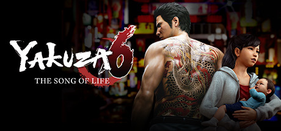

**Yakuza 6: The Song of Life is the emotional conclusion to Kiryu's saga, as the Dragon of Dojima emerges from prison to find Haruka in a coma and unravel a conspiracy tied to a mysterious baby. Features refined Dragon Engine combat and a beautifully crafted finale.**

---

## 📖 About

Yakuza 6: The Song of Life is the emotional conclusion to Kiryu's saga, as the Dragon of Dojima emerges from prison to find Haruka in a coma and unravel a conspiracy tied to a mysterious baby. Features refined Dragon Engine combat and a beautifully crafted finale.

## ⚠️ Problems Without Trainer

| Problem | Status |
|---------|--------|
| **Dragon Engine Transition** — Some combat systems from previous games removed or simplified | ✅ Solved |
| **Side Content Volume** — Clan Creator, Baseball, and substories require significant time to complete | ✅ Solved |
| **Pacing** — Opening sections are deliberately slow before action escalates | ✅ Solved |
| **Final Chapter Difficulty** — End-game fights are significantly harder than mid-game content | ✅ Solved |

## ✅ Solution

The **Yakuza 6 Trainer** solves all these issues by giving you complete control over the game.

## 🎯 Full Feature List

- Unlimited Resources
- God Mode / Invincibility
- Instant Skill Cooldown
- One-Hit Kill
- Freeze Game Timer
- Unlock All Items & Achievements
- Custom Speed Multiplier
- Save State Anywhere

## 🚀 Quick Start

1. **Disable Windows Defender** temporarily (trainer may trigger false positive)
2. Download the trainer from the button above
3. Launch Yakuza 6
4. Run the trainer as Administrator
5. Activate desired cheats with hotkeys

## 💎 Free vs Paid

| Feature | Free | Pro |
|---------|------|-----|
| Basic God Mode | ✅ | ✅ |
| Unlimited Resources | ✅ | ✅ |
| All Advanced Cheats | ❌ | ✅ |
| Auto-Updates | ❌ | ✅ |
| Priority Support | ❌ | ✅ |

## 💻 Requirements

- Windows 10/11 (64-bit)
- Yakuza 6 (any version)
- .NET Framework 4.8+
- DirectX 11+

## 🍎 macOS

macOS users can use our alternative tool:

## ⚖️ Legal

This trainer is for educational and single-player use only. Use responsibly.

---

